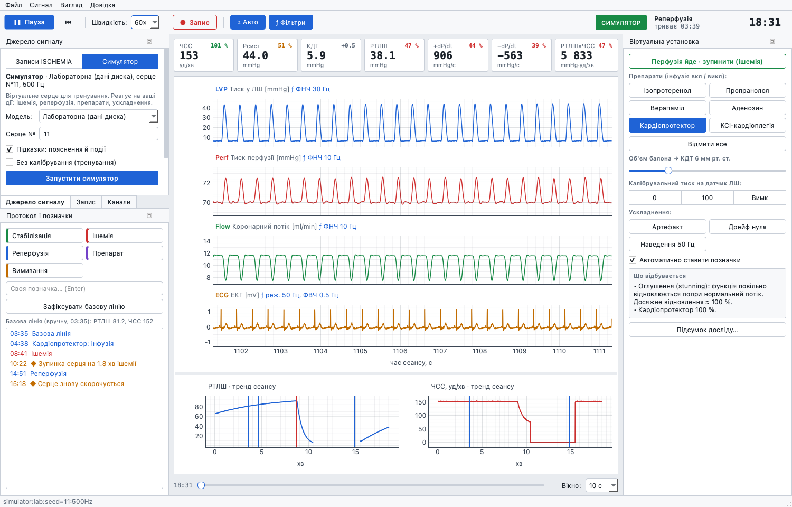

# LangRec

**Recording, analysis and a training simulator for isolated-heart (Langendorff) experiments.**
Cross-platform (Windows · macOS · Linux), portable, bilingual interface (Українська / English).



LangRec started as a modern successor to **ISCHEMIA**, a DOS acquisition program written in a
physiology lab in the 1990s for a Data Translation DT2801 ISA board. It reads that program's
files, replays them as if they were live, and adds what the old program never had: on-line
haemodynamics, baseline-relative readouts, digital filters, and a virtual heart to practise on.

## Features
- **Replay of legacy ISCHEMIA recordings** (`ISCH*.DAT` + `.MRK`, format reverse-engineered —
  see [docs/DAT_FORMAT.md](docs/DAT_FORMAT.md)): files of one experiment are joined,
  1×–60× speed, seeking, original markers.
- **Training simulator** — a virtual Langendorff heart that reacts to the operator:
  global ischemia and reperfusion (contractile failure, arrest, ischemic contracture,
  reperfusion arrhythmias incl. VF, stunning, duration-dependent recovery), drugs
  (isoproterenol, propranolol, verapamil, adenosine, KCl cardioplegia, a generic
  cardioprotector), balloon volume, calibration pressures, artefacts, zero drift, 50 Hz hum,
  on-screen physiological explanations and an end-of-experiment summary.
  The default model is tuned on real ischemia–reperfusion recordings — see [docs/SIMULATOR.md](docs/SIMULATOR.md).
- **On-line haemodynamics** from LV pressure every second over the last 5 s: HR, systolic
  pressure, EDP, LVDP, ±dP/dt, rate–pressure product — and **% of baseline** for each.
- **Protocol markers** (stabilisation / ischemia / reperfusion / drug / washout, Ctrl+1…5, or
  free text), current phase and its duration in the toolbar, session trends of LVDP and HR.
- **Digital filters** per channel (Butterworth low-/high-pass, 50/60 Hz notch, median spike
  removal) for display and analysis; the **raw** signal is what gets recorded.
- **Autoscale** that does not jump with every beat; drag a Y axis for manual scale, double-click to return.
- **Recording** to plain CSV (+ JSON session description) that opens in anything.
- **Calibration**: linear V → units per channel, two-point calibration helper.
- Light and dark themes; Ukrainian and English interface, switchable on the fly.

Not yet: acquisition from a real ADC board. The interface is ready for it — see
[Hardware](#hardware-for-live-recording) below.

## Hardware for live recording
Replay and the simulator need nothing but a computer. To record a **live** heart, the analogue
signals from the rig have to be digitised by an **ADC** (analogue-to-digital converter) — today
usually a small external **USB data-acquisition (DAQ) device**. It is the modern replacement
for the ISA board (DT2801) that sat inside the old Windows 98 PC.

```
balloon in the LV ─► pressure transducer ─► bridge amplifier ─► USB DAQ (ADC) ─► USB ─► computer running LangRec
perfusion line    ─► pressure transducer ─► bridge amplifier ─┘      ▲
flow meter / ECG amplifier ───────────────────────────────────────────┘   (one analogue input per signal)
```

- **Transducers** turn pressure (or flow) into a tiny voltage.
- **Amplifiers** (bridge amplifiers for pressure transducers) scale it to volts, typically ±10 V.
  Existing rigs usually already have them.
- **The DAQ** measures each input many times per second and streams the numbers over USB.

What to look for in a DAQ:

| | Minimum | Why |
|---|---|---|
| Input range | **±10 V** | matches the amplifiers' output (the old board had ±10.24 V) |
| Resolution | 12 bit (16 bit better) | 12 bit ≈ 5 mV steps on ±10 V |
| Sampling rate | **≥ 500–1000 Hz per channel** | enough for dP/dt and ECG (the old program used 100 Hz) |
| Channels | 4–8 analogue inputs | LV pressure, perfusion pressure, flow, ECG, temperature |
| Drivers | Windows, macOS, Linux | keeps LangRec cross-platform |

Typical devices (approximate prices — check current listings):

| Device | Price | Notes |
|---|---|---|
| **LabJack T7** | ~$500–700 | 16–24 bit, ±10 V, differential inputs, all three OSes, Python library — **recommended** |
| LabJack T4 | ~$300 | 12 bit, ±10 V on a few inputs — a budget option |
| MCC USB-1608G / USB-1208FS-Plus | ~$300–800 | good hardware; different libraries for Windows and Linux/macOS |
| NI USB-6001 / 6002 / 6211 | ~$300–1500 | no macOS drivers |
| Arduino / Teensy + ADS1256 | ~$50 | cheapest; needs electronics work to accept ±10 V |
| ADInstruments PowerLab | $$$$ | complete commercial system with its own software (LabChart) |

Besides the DAQ you usually only need cables from the amplifiers' BNC outputs to the DAQ inputs
(e.g. BNC-to-wire adapters for screw terminals).

**Status:** no DAQ is supported yet. The program is built so that a device needs one small source
module (see [docs/ARCHITECTURE.md](docs/ARCHITECTURE.md#adding-a-real-adc-board)); it will be
written and tested once a device is chosen. Details and open questions: [docs/HARDWARE.md](docs/HARDWARE.md).

## Download and run
Portable builds for Windows, macOS and Linux are produced by GitHub Actions
(*Actions → Build → artifacts*, or the *Releases* page).

| System | Run |
|---|---|
| Windows | `LangRec.exe` in the unpacked folder |
| macOS | `LangRec.app` (first time: right-click → Open — the app is not notarised) |
| Linux | `./LangRec` in the unpacked folder |

A `portable.txt` next to the program keeps settings and sessions in `LangRec_data/` beside it.

Keyboard: **Space** start/pause · **Ctrl+1…5** protocol markers · **Ctrl+B** set baseline ·
**Ctrl+R** record · **Ctrl+Shift+F** filters.

## From source
```bash
pip install -r requirements.txt          # or: conda env with numpy scipy pyside6 pyqtgraph
python -m langrec                         # start
python -m langrec --simulator --speed 10  # straight into the simulator
python -m langrec --replay path/to/folder --autostart
python -m pytest -q                       # tests (legacy-file tests need LANGREC_ARCHIVE)
python build_app.py                       # portable build for this OS → dist/
```

## Documentation
- [docs/ARCHITECTURE.md](docs/ARCHITECTURE.md) — how the program is organised, how to add a board
- [docs/SIMULATOR.md](docs/SIMULATOR.md) — the heart model, its data basis and limits
- [docs/DAT_FORMAT.md](docs/DAT_FORMAT.md) — the legacy ISCHEMIA file format
- [docs/HARDWARE.md](docs/HARDWARE.md) — choosing a modern ADC board
- [docs/DEVLOG.md](docs/DEVLOG.md) — development log: what was done, when and why

## Licence
MIT — see [LICENSE](LICENSE). The simulator is a teaching tool, not a validated physiological model.
