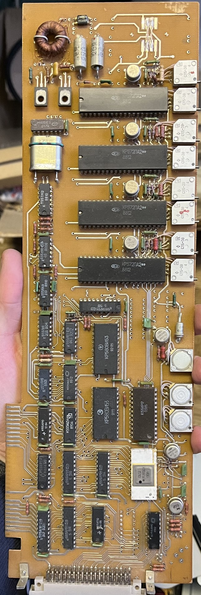

# The original ADC board

This is the board that sat in the old lab PC and digitised the signals for ISCHEMIA. It did
**not** process the data — it converted the amplifiers' voltages into numbers; ISCHEMIA on the
PC did the display, calculations and saving. A modern USB DAQ ([HARDWARE.md](HARDWARE.md))
replaces exactly this board.

Identification is from a photo of the component side; nothing was measured on the board itself.

## What is on it
| Part | What it is | Role (inferred) |
|---|---|---|
| Gold edge connector, bottom left | 8-bit **ISA** bus | plugs into the PC motherboard — no current PC has ISA slots |
| Date codes **8810–8812**, Soviet part numbers | made around **1988** in the USSR | |
| 4 × **КР572ПА2** | 12-bit multiplying DACs (Soviet, CMOS) | one forms the ADC together with a comparator and the SAR register; the others most likely provide analogue outputs or programmable offsets |
| **К155ИР17** | successive-approximation register (SAR) | the logic of a **12-bit successive-approximation ADC** — matching the 12-bit data in the files |
| White ceramic package (likely **К1100СК2**) | sample-and-hold amplifier | freezes the input voltage during conversion — ISCHEMIA's text "This channel triggers Sample&Hold" refers to it |
| **КР580ВИ53** | programmable interval timer (i8253 equivalent) | the sampling clock (sampling rate) |
| **КР580**-series interface chip, К555/К155 logic, **К556РТ** PROM | bus interface, address decoding | talking to the PC |
| Round metal cans next to the DACs | operational amplifiers | input/output buffering, comparator |
| 8 white **СП5-3В** trimmers | multi-turn trimming resistors | calibration of zero and gain per channel |
| Toroid, transistors, large capacitors (top left) | DC–DC converter / regulators | ±15 V analogue supply from the PC's +5/+12 V |
| Connector at the bottom edge | analogue I/O connector | the cable from the rig's amplifiers |

## How it relates to the software
ISCHEMIA uses the STEMMER "TL 4.0" library with a configuration for the **Data Translation
DT2801** (file `AD2801.HWD`). This board is therefore most likely a Soviet clone of the DT2801
or register-compatible with it. The recordings agree with that: 12 bit, ±10.24 V, ADC inputs
0, 2, 4, 100 Hz per channel (see [DAT_FORMAT.md](DAT_FORMAT.md)).

## Why keep it
The board itself cannot be used with modern computers, but **its cable and connector document
how the rig was wired**: which wire carried which signal (LV pressure, perfusion pressure, the
hardware dP/dt) and which was ground. Tracing those wires to the amplifiers gives the wiring for
the new USB DAQ. Keep the board and the cable until the new device is connected and calibrated.

To do (when possible): photograph the connector pins and the cable labels, trace the three
signal wires used by ISCHEMIA (inputs 0, 2, 4) and record the pinout here.
